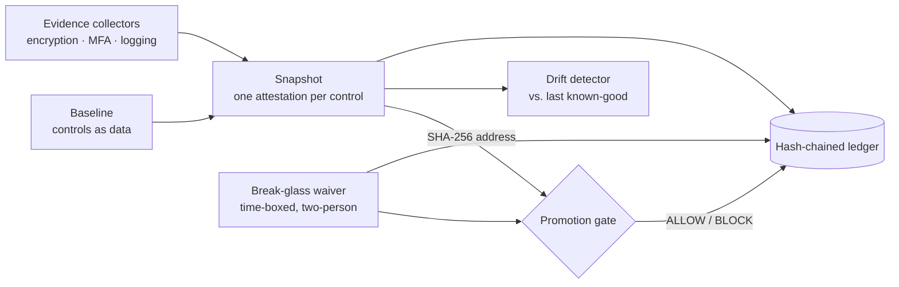

# GovOps Compliance Control Plane

**A Go control plane that blocks a release from reaching a regulated production environment unless it can prove — with tamper-evident evidence — that every compliance control holds right now.**

Passing an audit once is easy; staying compliant while shipping every week is the hard part. This project models the operational side of a FedRAMP-style government cloud: controls are versioned data, evidence is collected by pluggable checkers, every snapshot is content-addressed, and every promotion decision lands in a hash-chained ledger an auditor can verify.



## Why it's interesting

- **Fails closed everywhere.** A control with no registered collector, or a collector that errors, is `unknown` — and `unknown` counts as non-compliant. Only an explicit `pass` satisfies a control.
- **Blocked releases say *why*.** The gate returns the exact controls that stopped promotion, with status and observed evidence, rather than a bare "no".
- **Order-independent snapshot hashes.** Attestations are sorted by control ID and stripped of timestamps before hashing, so the same compliance facts always produce the same `sha256:` address — even if collectors run concurrently. A "chaos" test proves a naive unsorted hash diverges under reordering while the real one does not.
- **Tamper-evident audit trail.** Each ledger entry commits to the previous entry's hash; `Verify()` returns the first index where the chain breaks.
- **Break-glass with guardrails.** Waivers require a justification, an approver different from the requester, and a future expiry — and are written to the ledger *before* they can be used. Expired waivers stop counting automatically.
- **Drift detection that doesn't let controls disappear.** A control that was passing and is now failing — or has dropped out of measurement entirely — is reported as a regression.

## Quick start

Requires Go 1.22+. No external dependencies.

```bash
git clone https://github.com/AliAzamat/govops-compliance-control-plane.git
cd govops-compliance-control-plane

go test ./...          # gate, drift, ledger, and snapshot invariants
go run ./cmd/govops    # loads the gov-prod-moderate baseline and logs its controls
```

Expected output from `go run`:

```json
{"level":"INFO","msg":"loaded compliance baseline","name":"gov-prod-moderate","controls":["SC-28","IA-2","AU-2"]}
```

## Usage

The control plane is a set of small, typed packages. A promotion check looks like this:

```go
b := catalog.GovProdModerate()

reg := evidence.Registry{}
reg.Register(evidence.EncryptionAtRest{AllVolumesEncrypted: false}) // SC-28 will fail
reg.Register(evidence.MFAEnforced{OperatorsWithoutMFA: 0})
reg.Register(evidence.LoggingEnabled{AuditPipelineHealthy: true})

snap := snapshot.Take(b, reg, time.Now().UTC())
d := promote.Gate("rel-42", snap, b, nil, time.Now().UTC())

fmt.Println(d.Reason())
// BLOCK staging -> gov-prod: 1 control(s) not compliant
//   - SC-28 [fail] one or more volumes are unencrypted at rest
```

The operator surface in `cmd/govops/cli.go` wraps these calls (`Snapshot`, `Gate`, `Drift`, `Waive`, `VerifyLedger`) with stable exit codes so automation can branch on the result:

| Exit code | Meaning |
|---|---|
| `0` | Compliant / allowed / no drift / ledger intact |
| `2` | Non-compliant, blocked, drift detected, or ledger tampered |
| `1` | Operational error (e.g. waiver refused, no known-good snapshot) |

## Project layout

| Package | Responsibility |
|---|---|
| `internal/catalog` | Controls and baselines as data (`SC-28`, `IA-2`, `AU-2`) |
| `internal/evidence` | `Collector` interface, registry, deny-by-default attestation |
| `internal/snapshot` | Point-in-time snapshot and canonical SHA-256 address |
| `internal/promote` | Staging → gov-prod gate with waiver handling |
| `internal/drift` | Regression/recovery diff against a known-good snapshot |
| `internal/ledger` | Append-only, hash-chained event log with verification |
| `internal/breakglass` | Time-boxed, two-person waivers recorded before use |
| `cmd/govops` | Entry point and operator API |

## Tech stack

Go standard library only — `crypto/sha256` for content addressing and chaining, `encoding/json` for canonical serialization, `log/slog` for structured output.

## Status and limitations

This is a working model of the control-plane logic, not a deployable service.

- Collectors read injected facts rather than querying real systems (KMS, identity provider, log pipeline), which keeps tests deterministic.
- The bundled baseline has three controls; real FedRAMP baselines have hundreds, but the data shape is the same.
- The ledger is in-memory; there is no persistence layer yet.
- `main.go` currently only loads the baseline. The operator subcommands exist as methods on `App` but are not yet wired to command-line argument parsing.
- The Go module path is `github.com/khwajalabs/govops`, so `go install` from this repository's URL won't resolve; build from a clone.
